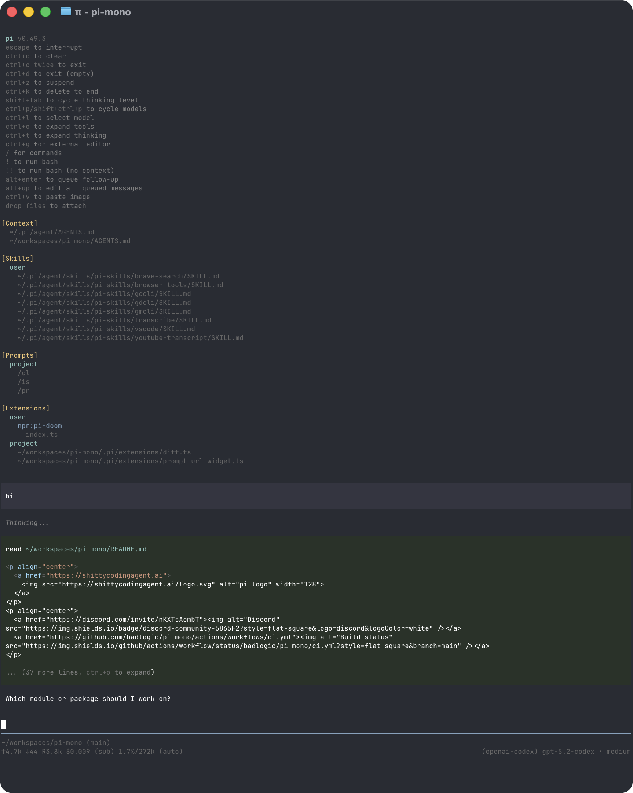

# Using Optimus

This page collects day-to-day usage details for Optimus by Telemus AI that do not fit on the quickstart page.

In IPython mode, Optimus provides a persistent Python REPL kernel. The kernel retains Python state across turns and acts as a control environment for file operations, project commands, installed Python skills, MCP-backed skills, and recursive subagents. The native Rust host remains responsible for provider calls, session state, tool execution, scheduling, and child-agent lifecycles. Use `/mode` to select another supported execution mode.

The installed launcher stores settings and sessions under `~/.config/optimus-rust/`. The source runner defaults to the inherited `~/.prime/agent/` profile. Set `PRIME_AGENT_CODING_AGENT_DIR` to choose a different profile; global paths below refer to the installed profile. Project configuration keeps its `.prime/agent/` path.

## Interactive Mode

<p align="center"></p>

The interface has four main areas:

- **Startup header** - compact brand and runtime summary; `--verbose` also lists loaded context files, prompt templates, skills, and extensions
- **Messages** - user messages, assistant responses, tool calls, tool results, notifications, errors, and extension UI
- **Editor** - where you type
- **Footer** - empty by default; use `/usage` for token, cost, and context details

The editor can be replaced temporarily by built-in UI such as `/settings` or by custom extension UI.

### Streaming speed

`STREAM TPS` shows the combined current output rate of the selected chat and
its streaming descendants. Two active agents at 80 and 60 TPS show approximately
140 TPS. Completed agents stop contributing, even while their rows remain visible.

The `~` prefix marks a character-based token estimate. The meter uses fresh
counter differences over a short rolling window, excludes the first buffered
snapshot and final provider-usage corrections, and decays when output pauses.
It shows `0.0` when no measured streams are active and `—` while establishing
a baseline or when telemetry is unavailable. These are client-observed rates;
network buffering can affect them, and they are not GPU decode measurements.
Per-agent resource rows retain the session's duration-weighted historical average.

The communication lights precede their labels: `○ TXT  ○ OCC1  ○ OCC2`.
They illuminate on new deliveries. A red circle precedes `HB` when a user or
agent heartbeat is enabled; a newly observed heartbeat run briefly flashes it.
Paused heartbeats retain their text label without the red circle.

### Editor Features

| Feature | How |
|---------|-----|
| File reference | Type `@` to fuzzy-search project files |
| Path completion | Press Tab to complete paths |
| Multi-line input | Shift+Enter, or Ctrl+Enter on Windows Terminal |
| Images | Paste with Ctrl+V, Alt+V on Windows, or drag into the terminal |
| Shell command | `!command` runs and sends output to the model |
| Hidden shell command | `!!command` runs without sending output to the model |
| External editor | Ctrl+G opens `$VISUAL` or `$EDITOR` |

See [Keybindings](keybindings.md) for all shortcuts and customization.

## Slash Commands

Type `/` in the editor to open command completion. Extensions can register custom commands, skills are available as `/skill:name`, and prompt templates expand via `/templatename`.

| Command | Description |
|---------|-------------|
| `/login`, `/logout` | Manage OAuth or API-key credentials |
| `/model` | Switch models |
| `/effort` | Set the reasoning/thinking level |
| `/scoped-models` | Enable/disable models for Ctrl+P cycling |
| `/settings` | Thinking level, theme, message delivery, transport |
| `/resume [id\|path]` | Open the agents view, or resume a session directly |
| `/new` | Start a new session |
| `/name <name>` | Set session display name |
| `/session` | Show session file, ID, and message counts |
| `/traces [status\|on\|off\|preview\|upload-current\|upload-all\|login]` | Preview, upload, or manage opt-in trace sharing |
| `/usage`, `/context` | Show the parent and subagent context, token, and cost breakdown |
| `/tree` | Jump to any point in the session and continue from there |
| `/fork` | Create a new session from a previous user message |
| `/clone` | Duplicate the current active branch into a new session |
| `/compact [prompt]` | Manually compact context, optionally with custom instructions |
| `/refine [instructions]` | Refine or roll back session-backed harness state |
| `/copy` | Copy last assistant message to clipboard |
| `/btw <question>`, `/side <question>` | Ask an inline side question without adding it to the session; replies continue the side conversation, esc returns |
| `/export [file]` | Export session to HTML |
| `/share` | Upload as private GitHub gist with shareable HTML link |
| `/reload` | Reload keybindings, extensions, skills, prompts, and context files |
| `/hotkeys` | Show all keyboard shortcuts |
| `/changelog` | Display version history |
| `/quit` | Quit Optimus |

### Clipboard feedback

Mouse-selection copy and `/copy` show feedback for three seconds, then remove only
that notice. Other status messages remain unchanged. Repeated copies restart the
notice timer. “Copied to local clipboard” means a local backend accepted the text;
terminal forwarding remains explicitly unconfirmed and requires OSC 52 support.
Copy failures remain visible as errors.

## Message Queue

You can submit messages while the agent is still working:

- **Enter** queues a steering message, delivered after the current assistant turn finishes executing its tool calls.
- **Alt+Enter** queues a follow-up message, delivered after the agent finishes all work. **Shift+Enter** never queues: it is reserved for inserting a newline so multi-line drafts work in the main prompt.
- **Ctrl+C** interrupts the current operation and briefly shows the exit hint; press it again while the hint is visible to exit. Queued messages are kept and resume after your next submit or edit.
- **Escape** clears the input bar without interrupting the agent.
- **Alt+Up / Alt+Down** browse queued messages one at a time and return to the untouched draft.
- While browsing, **Enter** applies the edit as steering input and **Alt+Enter** applies it as a follow-up; submitting an empty edit deletes the item.
- **Ctrl+Option+Up / Ctrl+Option+Down** move the selected item earlier or later within its queue.

On Windows Terminal, Alt+Enter is fullscreen by default. Remap it as described in [Terminal setup](terminal-setup.md) if you want Optimus to receive the shortcut.

Configure delivery in [Settings](settings.md) with `steeringMode` and `followUpMode`.

## Sessions

Sessions are saved automatically as flat JSONL files under `~/.config/optimus-rust/sessions/`. Each session header records its working directory, which the session picker uses for project-scoped views.

```bash
optimus-agent -c                  # Continue most recent session
optimus-agent -r [path|id]        # Browse sessions or resume one directly
optimus-agent --no-session        # Ephemeral mode; do not save
optimus-agent --fork <path|id>    # Fork a session into a new session file
```

Useful session commands:

- `/session` shows the current session file and ID.
- `/usage` shows token, cost, and context usage.
- `/tree` navigates the in-file session tree and can summarize abandoned branches.
- `/fork` creates a new session from an earlier user message.
- `/clone` duplicates the current active branch into a new session file.
- `/compact` summarizes older messages to free context.

See [Sessions](sessions.md) and [Compaction](compaction.md) for details.

## Agents and Recursive Subagents

Normal interactive sessions are persistent agents backed by isolated worker processes. Closing the TUI detaches the client; use `optimus-agent agents`, `optimus-agent list`, or `optimus-agent attach <agent>` to find and reattach to running work. `optimus-agent stop <agent>` stops one root agent, while `optimus-agent shutdown` stops all workers and the local supervisor.

Within a session, the model can delegate through the `rlm` callable already available in the Python REPL:

```python
# Spawn independent children. Each call returns at admission with a child handle,
# never the child's answer.
review = await rlm(
    "Review authentication and reply to the parent with findings.",
    name="auth-reviewer",
)
tests = await rlm("Find missing regression tests and reply to the parent.", name="test-reviewer")
docs = await rlm("Find stale public documentation and reply to the parent.", name="docs-reviewer")

# Children reply from their own sessions with:
# await agent_message.send(message, receiver_role="parent")
# Their replies arrive here as ordinary agent messages.

# Recover handles and follow up with a retained child.
children = await rlm.list_subagents()
await agent_message.send(
    "Also check authorization boundaries.",
    receiver_role="child",
    receiver_name=review.name,
)
```

Children inherit the parent model unless the user requests another model. They use the same native agent runtime, provider, tools, skills, session storage, and scheduling system. See [RLM Runtime Architecture](rlm-runtime.md).

## Context Files

Optimus loads `AGENTS.md` or `CLAUDE.md` at startup from:

- `~/.config/optimus-rust/AGENTS.md` for global instructions
- parent directories, walking up from the current working directory
- the current directory

Use context files for project conventions, commands, safety rules, and preferences. Disable loading with `--no-context-files` or `-nc`.

### System Prompt Files

Replace the default system prompt with:

- `.prime/agent/SYSTEM.md` for a project
- `~/.config/optimus-rust/SYSTEM.md` globally

Append to the default prompt without replacing it with `APPEND_SYSTEM.md` in either location.

## Exporting and Sharing Sessions

Use `/export [file]` to write a session to HTML.

Use `/share` to upload a private GitHub gist with a shareable HTML link.

## CLI Reference

```bash
optimus-agent [options] [@files...] [messages...]
```

### Shell Commands

```bash
optimus-agent agents
optimus-agent list [--all]
optimus-agent attach <agent>
optimus-agent stop <agent>
optimus-agent rename <agent> <name>
optimus-agent send <agent> <message>
optimus-agent schedule <list|add|cancel>
optimus-agent status
optimus-agent doctor [--fix]
optimus-agent shutdown [--force]

optimus-agent package install <source> [--local]
optimus-agent package remove <source> [--local]
optimus-agent package list
optimus-agent package update [source]
optimus-agent update [--force]
optimus-agent config
```

See [Optimus Packages](packages.md) for package sources and security notes.

### Modes

| Flag | Description |
|------|-------------|
| default | Interactive mode |
| `-p`, `--print` | Print response and exit |
| `--mode json` | Output all events as JSON lines; see [JSON mode](json.md) |
| `--mode rpc` | RPC mode over stdin/stdout; see [RPC mode](rpc.md) |

In print mode, Optimus also reads piped stdin and merges it into the initial prompt:

```bash
cat README.md | optimus-agent -p "Summarize this text"
```

### Model Options

| Option | Description |
|--------|-------------|
| `--provider <name>` | Provider, such as `anthropic`, `openai`, or `google` |
| `--model <pattern>` | Model pattern or ID; supports `provider/id` and optional `:<thinking>` |
| `--api-key <key>` | API key, overriding environment variables |
| `--thinking <level>` | `off`, `minimal`, `low`, `medium`, `high`, `xhigh`, or `max` |
| `--models <patterns>` | Comma-separated patterns for Ctrl+P cycling |

Use `optimus-agent model list [search]` to list available models.

### Session Options

| Option | Description |
|--------|-------------|
| `-c`, `--continue` | Continue the most recent session |
| `-r`, `--resume [path\|id]` | Browse and select a session, or resume a specific session file or partial UUID |
| `--fork <path\|id>` | Fork a session file or partial UUID into a new session |
| `--session-dir <dir>` | Custom session storage directory |
| `--no-session` | Ephemeral mode; do not save |

Use `optimus-agent session export <file> [output]` to export a session to HTML.

### Tool Options

| Option | Description |
|--------|-------------|
| `--tools <list>`, `-t <list>` | Allowlist specific built-in, extension, and custom tools |
| `--no-builtin-tools`, `-nbt` | Disable built-in tools but keep extension/custom tools enabled |
| `--no-tools`, `-nt` | Disable all tools |

The built-in tool set depends on the selected execution mode; IPython mode provides `ipython`.

### Resource Options

| Option | Description |
|--------|-------------|
| `-e`, `--extension <source>` | Load an extension from path, npm, or git; repeatable |
| `--no-extensions`, `-ne` | Disable extension discovery |
| `--skill <path>` | Load a skill; repeatable |
| `--no-skills`, `-ns` | Disable skill discovery |
| `--prompt-template <path>` | Load a prompt template; repeatable |
| `--no-prompt-templates`, `-np` | Disable prompt template discovery |
| `--theme <path>` | Load a theme; repeatable |
| `--no-themes` | Disable theme discovery |
| `--no-context-files`, `-nc` | Disable `AGENTS.md` and `CLAUDE.md` discovery |

Combine `--no-*` with explicit flags to load exactly what you need, ignoring settings. Example:

```bash
optimus-agent --no-extensions -e ./my-extension.ts
```

### Autonomous Options

Autonomous mode is a host policy for unattended work. It starts disabled. `--autonomous` enables it, and supplying any `--autonomous-*` sub-option also enables it. The host starts each enabled run with fresh continuation, turn, token, and elapsed-time counters.

| Option | Behavior, units, and default |
|--------|------------------------------|
| `--autonomous` | Enable autonomous continuations. With no gates, the host keeps requesting work until a limit prevents another continuation. |
| `--autonomous-gate <command>` | Add a shell command that must pass before the run can finish. Repeatable commands run in CLI order; the default is no gates. |
| `--autonomous-gate-retries <n>` | Set the per-gate retry limit. Default: `3`. A failed gate can continue while its recorded attempt is at most this value; the next failed attempt exhausts the gate. |
| `--autonomous-gate-timeout-ms <n>` | Set the timeout for each gate process in milliseconds. Default: `300000` (5 minutes). A timed-out gate is failed and its process tree is stopped. |
| `--autonomous-max-continuations <n>` | Set the maximum host-injected follow-up messages. Default: `3`. |
| `--autonomous-max-turns <n>` | Set the maximum assistant responses counted while autonomous mode is enabled. Default: `12`. |
| `--autonomous-max-tokens <n>` | Set the maximum accumulated tokens. Default: `80000`; accounting includes input, output, and cache-write tokens, but excludes cache-read tokens. |
| `--autonomous-timeout-ms <n>` | Set the maximum elapsed autonomous time in milliseconds. Default: `1800000` (30 minutes). |

All `<n>` values must be positive integers: zero, negative, fractional, and non-numeric values are rejected. Value-taking autonomous flags require a separate argument, not `--flag=value`. A missing value is rejected, and a following long option is not consumed as a value. Repeating a numeric flag uses its last value; repeating `--autonomous-gate` appends another gate.

After each assistant response, configured gates run before the ordinary continuation limits are evaluated. All gates must pass for the run to finish. A failed gate supplies bounded command output to the next continuation so the agent can repair it; Optimus avoids rerunning an unchanged failed gate and advances its attempt count instead. A passing gate permits completion even if a continuation, turn, token, or time limit has otherwise been reached. If a gate does not pass, or if there are no gates, the host can inject another continuation only while all four limits remain below their configured values. Limits are checked in this order: continuations, turns, tokens, then elapsed time. Reaching one prevents another automatic continuation; it does not imply task success.

For example, this noninteractive run uses a locally available model configuration, skips startup network operations, and bounds every autonomous budget while requiring the project check to pass:

```bash
optimus-agent -p \
  --autonomous \
  --autonomous-gate "npm run check" \
  --autonomous-gate-retries 2 \
  --autonomous-gate-timeout-ms 300000 \
  --autonomous-max-continuations 3 \
  --autonomous-max-turns 12 \
  --autonomous-max-tokens 80000 \
  --autonomous-timeout-ms 1800000 \
  --model openai/gpt-5.1-codex \
  --offline \
  --thinking high \
  "Fix the failing check and report the verified result."
```

`--offline` disables startup network operations; it does not supply model credentials or make provider inference offline. Choose a model already configured for the local environment.

Goals are separate from autonomous mode: `--goal <objective>` starts a persistent goal only for a new root session with no existing goal state, while autonomous mode decides whether the host should inject another continuation. `--goal-token-budget <n>` is a positive-integer token budget for that initial goal and requires `--goal`.

### Other Options

| Option | Description |
|--------|-------------|
| `--cwd <dir>` | Use a specific working directory for the session |
| `--system-prompt <text>` | Replace default prompt; context files and skills are still appended |
| `--append-system-prompt <text>` | Append to system prompt |
| `--verbose` | Force verbose startup |
| `--offline` | Disable startup network operations |
| `-h`, `--help` | Show help |
| `-v`, `--version` | Show version |
| `--` | End option parsing and treat all following arguments as messages |

### File Arguments

Prefix files with `@` to include them in the message:

```bash
optimus-agent @prompt.md "Answer this"
optimus-agent -p @screenshot.png "What's in this image?"
optimus-agent @code.ts @test.ts "Review these files"
```

### Examples

```bash
# Interactive with initial prompt
optimus-agent "List all .ts files in src/"

# Non-interactive
optimus-agent -p "Summarize this codebase"

# Non-interactive with piped stdin
cat README.md | optimus-agent -p "Summarize this text"

# Different model
optimus-agent --provider openai --model gpt-4o "Help me refactor"

# Model with provider prefix
optimus-agent --model openai/gpt-4o "Help me refactor"

# Model with thinking level shorthand
optimus-agent --model sonnet:high "Solve this complex problem"

# Limit model cycling
optimus-agent --models "claude-*,gpt-4o"

# Restrict to the built-in Python REPL tool
optimus-agent --tools ipython -p "Review the code"
```

### Environment Variables

| Variable | Description |
|----------|-------------|
| `PRIME_AGENT_CODING_AGENT_DIR` | Override config directory; the installed launcher defaults to `~/.config/optimus-rust`, while the source runner defaults to `~/.prime/agent` |
| `PRIME_AGENT_SESSION_DIR` | Override session storage directory; overridden by `--session-dir` |
| `PRIME_AGENT_CODING_AGENT_SESSION_DIR` | Legacy alias for `PRIME_AGENT_SESSION_DIR` |
| `PI_PACKAGE_DIR` | Override package directory, useful for Nix/Guix store paths |
| `PI_OFFLINE` | Disable startup network operations, including update checks and package update checks |
| `PI_SKIP_VERSION_CHECK` | Skip the Optimus version update check at startup. This prevents the release manifest request |
| `PRIME_AGENT_DOWNLOAD_BASE_URL` | Override the Optimus release manifest and tarball base URL |
| `PI_CACHE_RETENTION` | Set to `long` for extended prompt cache where supported |
| `PRIME_API_KEY` | Prime Inference API key; also used for trace sharing when it has `agent_traces` scope |
| `PRIME_AGENT_TRACES_API_KEY` | Prime API key used only for opt-in trace sharing |
| `PRIME_AGENT_TRACES_BASE_URL` | Override the Prime Intellect trace upload API base URL |
| `PRIME_AGENT_KERNEL_PYTHON` | Use an existing Python environment with `prime-agent-runtime` instead of the managed kernel environment |
| `VISUAL`, `EDITOR` | External editor for Ctrl+G |

The remaining `PI_*` and `PRIME_AGENT_*` variables are compatibility names still read by the current runtime. They do not change the application name or command. See the [installation guide](../../../docs/RUST_LAUNCHER.md) for installed profile and runtime paths.

## Design Principles

Optimus keeps the model-facing tool surface small while making the Python REPL runtime powerful and composable. The built-in `ipython` tool provides durable state, project command execution, Python skills, MCP-backed integrations, and the native `rlm` delegation API without presenting each capability as a separate model tool.

Recursive subagents are a core capability, not an optional extension. The native Rust host owns every parent and child agent loop so recursion uses the same provider, session, tool, skill, scheduling, usage-accounting, and recovery infrastructure. The Python `rlm` package is a thin host bridge rather than a separate agent implementation.

Extensions, skills, prompt templates, themes, and Optimus packages remain the primary customization surfaces. They can add project-specific workflows, custom tools and UI, permission policies, provider integrations, and orchestration patterns around the built-in runtime.

Optimus is maintained by Telemus AI and preserves attribution to its Prime Agent and Pi foundations. See the [acknowledgements](../../../README.md#foundations-and-acknowledgements) and [license](../../../LICENSE).
